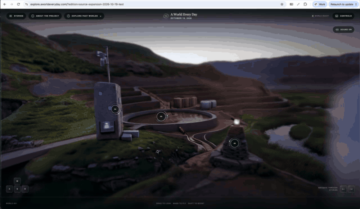
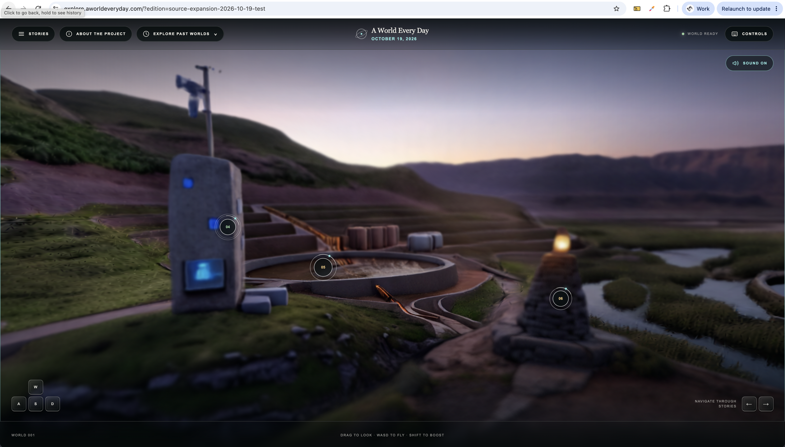
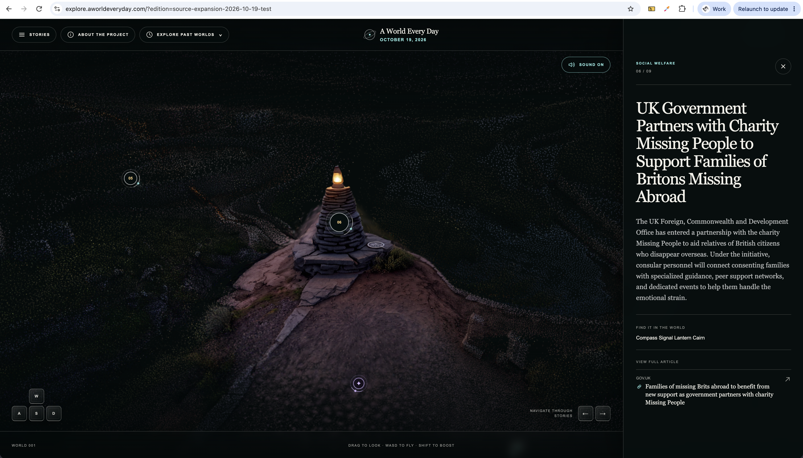
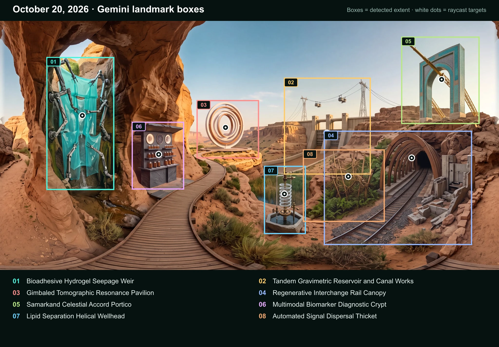

# A World Every Day

A living, evolving digital installation. Every day, a new world is generated
from developments in science, technology, culture, health, climate and
communities around the world.

Explore on desktop or mobile, with keyboard-and-mouse or touch controls.

[Explore today's world](https://explore.aworldeveryday.com) ·
[About the project](https://aworldeveryday.com) ·
[Quick start](#quick-start) · [Developer docs](docs/README.md) · [Contribute](CONTRIBUTING.md)

[](docs/assets/explorer-tour.mp4)

*Look around. Follow a landmark. Discover the story behind it. [Watch with sound](docs/assets/explorer-tour.mp4).*

**Early prototype.** The AWS pipeline runs from story discovery through public
publication, with a daily 7:30 AM Pacific development schedule. Editorial
breadth, visual quality, and daily reliability are still evolving. Failed runs
leave the previous world in place.

## Quick start

Run the local demo with **Node.js 20.9+**. No API keys or AWS account needed.

```bash
git clone https://github.com/acher249/world-every-day.git
cd world-every-day/frontend
npm i
npm start
```

Open [localhost:3000](http://localhost:3000). The demo uses fictional stories
and a poster fallback; a generated 3D world is optional.

For the full experience, [explore the live world](https://explore.aworldeveryday.com).
To run your own installation, see the [pipeline guide](pipeline/README.md) and
[AWS deployment guide](infra/aws/README.md). The separate project site lives in
[`marketing/`](marketing/).

To exercise the fictional pipeline without credentials or paid calls, start
from the repository root:

```bash
cd pipeline
npm i
npm run edition -- --date 2026-01-01 --run-dir ./artifacts/quick-start
```

This produces sample artifacts, including a publication manifest. Its mock
world is intentionally not a renderable 3D asset. Rerunning resumes or reuses
completed stages; it does not publish a website or post to X.

## Developer guides

| Work on | Guide |
| --- | --- |
| Discovery, editorial analysis, and local generation | [Pipeline](pipeline/README.md) |
| 360 image prompts and processing | [Panorama generation](docs/PANORAMA_GENERATION.md) |
| Daily schedule, state machines, and recovery | [AWS workflow](docs/AWS_WORKFLOW.md) |
| Video rendering, music, and archival | [Video generation](docs/WORLD_VIDEO_PLAN.md) |
| App authorization and automated video posts | [X posting](docs/DAILY_X_POSTS.md) |
| Infrastructure, domains, and secrets | [Deployment](infra/aws/README.md) |

The optional video/X branch runs after successful world publication. It archives
a ten-second tour with music and attaches it to the daily post. Both features
are disabled by default for new deployments. See the [docs index](docs/README.md)
for source policy, costs, and contribution checks.

## Why this exists

Information increasingly arrives as an endless feed: fragments competing for
attention and quickly displaced by whatever comes next. The news is perhaps the
clearest example: an unending stream of headlines, clickbait, conflict, and
crisis.

A World Every Day is an artistic exploration: what if information arrived as a
place?

The first experiment draws from reporting, newly published research, and
public-interest updates. The current sources often lean toward science, health,
and technology. Each morning, selected developments become a single explorable
world: a slower, more curious way of encountering what is happening around us
and across the world.

This is only the beginning. The same pattern could turn archives, community
knowledge, cultural collections, or entirely different kinds of information
into worlds of their own.

## The daily world

Each edition is a playful, diagrammatic world composed from a curated set of
recent developments. Ideas, discoveries, places, and events are brought
together as one limited, navigable environment: something to wander, look
around, and slowly explore.



*A landscape of stories to wander through and discover.*

Visitors move through it as an interactive 3D world. Its landmarks are more than
scenery: select one to learn what it represents, read the story behind it, and
follow the original sources when you want to go deeper.



*Select a landmark to bring it into focus, read the story behind it, and open the original source.*

As the project continues, the worlds become a living archive. You can return to
today, move backward through earlier editions, and see time not as a list of
headlines, but as a collection of places.

The explorer's **Explore Past Worlds** menu lists editions that previously held
the current-world position. Direct technical previews are not added to it.

## How it works

The reference implementation is a daily state-machine pipeline:

```text
reviewed official RSS and Atom feeds
      ↓
ten stories + summaries + links
      ↓
a generated image
      ↓
a world foundation model
      ↓
an interactive world + historical archive
```

The reference implementation uses official RSS and Atom feeds for story
discovery. It does not depend on social feeds or unbounded website collection.
The default feeds are reviewed for the full pipeline: after shortlisting, a
linked article may be read ephemerally for analysis. Feeds that cannot support
that step are excluded from the default, not collected as unusable candidates.
Source policies still require periodic review; inclusion is not legal clearance.

Feeds are the starting point, not a limitation of the underlying pattern. Source
adapters can be added for archives, datasets, APIs, private knowledge bases, or
other kinds of information when the operator has permission to access and use
them.

A world foundation model is a generative model that creates a spatial,
explorable environment from inputs such as images or text. In this project, an
image becomes the starting point for a 3D world rather than the final artifact.

A World Every Day is also an ongoing exploration of world foundation models.
As those models become more capable, the project will evolve with them, using
newer models to create worlds with greater fidelity, coherence, and possibility
over time.

The pipeline is designed to gather the day's information, preserve each story
and its sources in structured data, generate a single image from the selected
stories, and pass that image to World Labs Marble to create the spatial world.
The finished assets and story data are then brought together in an interactive
web experience rendered with Spark.js.

Source articles are processed **ephemerally in memory** and then discarded.
Their bodies and verbatim passages are never copied into project storage or
republished. Persistent artifacts contain source links and provenance, content
hashes, and original project-written summaries, claims, and visual details.
The default editorial route uses the paid Gemini API, with Bedrock Nova as an
optional adapter. For a Gemini API key tied to a project with
active billing, [Google's Paid Services terms](https://ai.google.dev/gemini-api/terms)
say it does not use prompts or responses to improve its products; limited
abuse-monitoring retention still applies. We keep article text bounded and
ephemeral in this project and review each source's permitted use. The
reference deployment uses this configuration. See the
[source-data boundary](docs/DATA_BOUNDARY.md) and
[deployment preflight](infra/aws/README.md#source-text-privacy-preflight).

## Technical architecture

AWS hosts and orchestrates the reference deployment: compute, storage, asset
delivery, secrets, and monitoring live in the project's AWS account. AWS Step
Functions coordinates each stage from collection through publication. Model
calls may go to Gemini, optional Bedrock Nova, Nano Banana, and World Labs.

The main building blocks are:

- [AWS](https://aws.amazon.com/) for the complete reference cloud deployment,
  with [AWS Step Functions](https://aws.amazon.com/step-functions/) at the center
  of the pipeline.
- [Gemini API](https://ai.google.dev/gemini-api/docs) for editorial analysis,
  with [Amazon Bedrock](https://aws.amazon.com/bedrock/) Nova as an
  optional alternative.
- [Nano Banana](https://ai.google.dev/gemini-api/docs/image-generation) for
  creating a 360-degree equirectangular source image from the selected stories.
- [World Labs Marble](https://www.worldlabs.ai/blog/marble-world-model) for
  turning that image into an explorable 3D world.
- [Spark.js](https://sparkjs.dev/) and [Three.js](https://threejs.org/) for
  rendering the generated Gaussian-splat world in the browser.
- [Next.js](https://nextjs.org/) and [Motion](https://motion.dev/) for the public
  web experience, interactions, and interface animation.

These pieces remain separable so contributors can introduce other sources,
generators, world models, interfaces, or cloud providers without rebuilding the
entire system.

Gemini identifies each story landmark in the generated panorama before the
pipeline maps its target into the 3D world. The image bounds also scale the
landmark's focus effect. This example shows the detected regions
(colored boxes) and raycast targets (white dots):



### Backend and infrastructure

Server-side stages live in `pipeline/`; the AWS CDK application lives in
`infra/aws/`. For local infrastructure settings, copy
`infra/aws/.env.example` to the ignored `infra/aws/.env.local`. That file is for
non-secret settings only. Use a named AWS CLI profile backed by IAM Identity
Center or an assumed role for AWS access, and keep provider credentials in AWS
Secrets Manager. See the [AWS infrastructure guide](infra/aws/README.md).

## Make it your own

This is an open building block, not a fixed news product. Follow the subjects
that matter to you, generate linked worlds for science, politics, technology, or
sports, layer data and analytics into the landscape, or turn yesterday's work—
including what your agents accomplished—into a daily spatial record.

The sources, editorial lens, generators, world models, and cloud can all change.
You do not need to be a 3D graphics or AI expert to begin; the local demonstration
works without paid services.

## Building the project

Optional [daily X posting](docs/DAILY_X_POSTS.md) can announce each world after
public publication is verified. It is disabled by default. Successful posts also
update the marketing page's latest-post embed without a site rebuild.
An additional opt-in [video branch](docs/WORLD_VIDEO_PLAN.md) renders a ten-second
tour with ambient music using concurrent Lambda batches, archives WebM and MP4
files, and waits for the finished video before posting to X. World publication
does not depend on this optional branch succeeding.

Development is organized around a manual end-to-end world first, followed by the
editorial engine, story discovery, public experience, and AWS automation. See the
[phased build plan](docs/BUILD_PLAN.md) for milestones, acceptance criteria, and
the path to an open-source release. The evolving visual system and generation
constraints live in the separate [art-direction guide](docs/ART_DIRECTION.md).

### Build with an agent

Point Claude Code, Codex, or another coding agent at this repository and away
you go. Ask it to read the [instructions for agents](AGENTS.md) first; they cover
the project structure, validation commands, licensing rules, and boundaries
around credentials, paid services, and deployment.

### Run the frontend

The current frontend is a full-viewport world explorer built with Next.js,
TypeScript, Motion, Three.js, and [Spark.js](https://sparkjs.dev/). Its fictional
sample edition pairs selectable landmarks with slide-out story panels and
requires no API keys. Without a splat asset, it displays the generated source
image as a poster; set the optional public
`NEXT_PUBLIC_WORLD_SPLAT_URL` described in `frontend/.env.example` to activate
the interactive Gaussian-splat viewer.

The explorer's project-site link defaults to `https://aworldeveryday.com`.
Forks can change it with the public `NEXT_PUBLIC_PROJECT_SITE_URL` build setting.

You will need Node.js 20.9 or newer and npm.

```bash
cd frontend
npm i
npm start
```

Then open [http://localhost:3000](http://localhost:3000). Environment variables
needed by future integrations will be documented in `frontend/.env.example`;
never commit a populated `.env` file.

### Run the project site

The separate `marketing/` application introduces the art project, links to the
open-source repository, and embeds the current explorer as a lazy-loaded preview.
The embedded preview is desktop-only; mobile visitors open the dedicated explorer.
Select **Start exploring** to interact; **Pause exploring** returns to page scrolling.
It is a static Next.js application with no credentials or server runtime.

```bash
cd marketing
npm i
npm start
```

Public links are configured at build time through `marketing/.env.example`.
They are intentionally browser-visible and must never contain secrets. The
reference deployment serves this site at the root domain and the immersive
`frontend/` application from the configurable `explore` subdomain.
For a production build, set `NEXT_PUBLIC_SITE_URL` and
`NEXT_PUBLIC_EXPLORER_URL` to their public HTTPS URLs; local `.env.local`
values are for development only. The build rejects a production root domain
that links visitors to a local explorer.

To preview a locally generated SPZ without committing it, copy it into the
ignored public-asset directory and set the public URL in `frontend/.env.local`:

```bash
cd frontend
npm run world:local -- --source ../pipeline/artifacts/world/<run>/<edition>/assets/world.spz --name local-world.spz
```

Then set `NEXT_PUBLIC_WORLD_SPLAT_URL=/generated/local-world.spz` and
`NEXT_PUBLIC_WORLD_SPLAT_SHA256` to the asset's SHA-256 checksum before
restarting the frontend. The checksum prevents baked hotspots from being reused
with the wrong world. These variables are public by design; provider credentials
remain in the server-side pipeline environment only.

The local vertical-slice utilities can bake detected panorama landmarks into a
matching SPZ and assemble an ignored local publication manifest. They require a
development browser with remote debugging enabled; see the local utility
commands in `frontend/package.json` and the environment placeholders in
`frontend/.env.example` before using them. The AWS workflow also runs private
browser-backed interaction baking before staging publication.

### Run the panorama pipeline

The first pipeline utility generates a 360-degree equirectangular image, repairs
its longitude seam, and prepares an 8192 × 4096 delivery asset. See the
[pipeline guide](pipeline/README.md) for setup, dry-run, and validation commands.
The guide also includes a no-cost `npm run edition` command that exercises the
complete resumable artifact chain locally with fictional providers.
For opt-in live provider runs, copy `pipeline/.env.example` to `pipeline/.env`
and populate the server-only keys documented there. The populated file is
ignored by Git and must never be committed.

### Validate the AWS infrastructure

The AWS CDK application in `infra/aws/` defines hosting, private artifacts,
publication state, monitoring, and the live daily pipeline. Its schedule is
disabled in a fresh deployment; the reference development stack has explicitly
enabled paid generation and public publication. Local synthesis does not deploy
resources or call providers.

```bash
cd pipeline
npm i
cd ../infra/aws
npm i
npm run synth
```

Synthesis is local and credential-free. See the
[AWS infrastructure guide](infra/aws/README.md) for configuration, cost guards,
and the explicit boundary around account-mutating commands.

## Contributing

Contributions are welcome across the frontend, editorial system, source and
generation adapters, cloud infrastructure, accessibility, documentation, and
entirely new ways of using the pattern. Read [CONTRIBUTING.md](CONTRIBUTING.md)
before opening an issue or pull request.

For security concerns, see [SECURITY.md](SECURITY.md).

## License and providers

Original code in this repository is released under the [MIT License](LICENSE).
Direct runtime dependencies must use approved permissive open-source licenses;
the dependency graphs are checked by `npm run license:check` in `frontend/`,
`marketing/`, `pipeline/`, and `infra/aws/`. See
[Third-Party Notices](THIRD_PARTY_NOTICES.md) and the full
[licensing and service-boundary policy](docs/LICENSING.md).

The reference deployment runs on AWS, while cloud-specific code remains behind
replaceable interfaces so contributors can add other providers.
AWS, Google Gemini/Nano Banana, and World Labs Marble are proprietary hosted
services and are not covered by the repository's MIT license. Users enable those
adapters with their own accounts, credentials, billing, and acceptance of the
providers' current terms. The local fixture-driven frontend requires none of
those credentials.

Paid services are optional for local development. Deploying an enabled daily
schedule authorizes unattended paid calls; review its settings and costs before
turning it on. See the [cost guide](docs/COSTS.md) for a daily estimate and the
main ways spending can grow.
