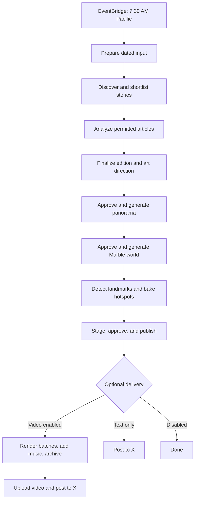

# AWS daily workflow

AWS Step Functions coordinates the daily edition. Lambda runs individual
stages, S3 stores immutable artifacts and public assets, and DynamoDB supports
state and coordination. Deployment instructions live in the
[AWS guide](../infra/aws/README.md); this page explains execution and recovery.

## State machines

| Workflow | Purpose |
| --- | --- |
| `DailyTriggerStateMachine` | Converts the scheduler timestamp into an edition ID and starts the live workflow |
| `LiveCollectionStateMachine` | Discovers stories, generates and publishes a world, then optionally creates a video and X post |
| `EditionStateMachine` | Fictional fixture workflow; no live provider calls |
| `VideoWorkflow` / `VideoBackfillWorkflow` | Separate optional test-stack workflows for existing published worlds; they do not post |

Use CloudFormation outputs for deployed ARNs; names contain generated suffixes.
The main workflow is exposed as `LiveCollectionStateMachineArn`.

## Story library and quiet days

The collector reads up to 72 hours of feed metadata in one pass. Selection
prioritizes the newest eligible stories, so 48–72-hour candidates fill gaps
when the last day is quiet. Unused eligible stories from the previous 14 days
are also available, newest first. The target remains ten; one to nine usable
stories can still generate a world. Zero usable stories stops the run.

Candidate assessments use Gemini's constrained JSON output when that provider is
selected, followed by strict local schema, score-range, and story-coverage
validation. Malformed batches get up to three model attempts with concise
validation feedback; they never enter the final evaluation artifact. Each valid
ten-story batch is saved as an immutable checkpoint, so a retried shortlist
resumes completed batches. Shortlist Lambda timeouts are retried against those
checkpoints, with a 15-minute invocation limit.

Landmark detection treats `not-found` as a recoverable model result: it asks the
vision model to re-scan the panorama with the missing subject descriptions, up
to three paid attempts total. If a subject is still not located, it is excluded
from raycasting and the public story list; located stories still publish when
at least one has a validated world-space anchor. The complete landmark artifact
remains private for diagnosis. The run stops before publication only when no
selected story can be anchored, or when another required asset fails
validation. This avoids inventing hotspot positions and avoids discarding an
otherwise usable world because one detector result was incomplete.

The library reuses immutable candidate metadata and evaluations already in
private S3; it does not store article text or need another database. It admits
only the 50 newest unused eligible stories alongside up to 100 newly discovered
candidates. The active backlog is recalculated for each new run: newer eligible
stories displace older ones. Older audit records remain separate from this cap.
Each edition records a checksum-bound `sources/library-snapshot.json`, so retries
reuse the same inputs. Matching model/prompt evaluations are reused, with recency
recalculated; changed evaluators assess the candidates again.

Published source URLs and recorded event keys prevent reuse. Publication history
is authoritative: a failed or merely staged edition does not consume stories.
Current source permissions and editorial quality/diversity rules still apply,
and selected articles are fetched and analyzed again before publication. Stories
older than 14 days remain in audit artifacts but are not eligible for reuse.
Run one live daily edition at a time; a collection snapshot does not reserve
stories against another concurrently running edition.

## Schedule and authorization

The schedule uses `cron(30 7 * * ? *)` and `America/Los_Angeles`, so it follows
Pacific daylight-saving changes. The scheduled timestamp determines
`daily-YYYY-MM-DD` and the preferred previous 24-hour story window. A stable execution
name prevents scheduler retries from intentionally creating another edition.
7:30 AM is the start time, not the publication time.

Fresh deployments disable scheduling. Setting
`WORLD_EVERY_DAY_ENABLE_SCHEDULE=true` opts into the full unattended daily
input, including paid generation and public publication. Keep this setting
in the deployment configuration on subsequent deployments.

Manual inputs may stop at individual gates:

| Input flag | Enables |
| --- | --- |
| `confirmPaidAnalysis` | Candidate evaluation and shortlist |
| `confirmLiveArticleFetch` + `confirmPaidArticleAnalysis` | Permitted article reading and analysis |
| `confirmPaidArtDirection` | Scene composition |
| `confirmPaidPanorama` | Image generation |
| `confirmPaidWorld` | Marble generation |
| `confirmPaidLandmarks` | Image-based landmark detection |
| `confirmPublish` | Public publication and current-world update |
| `confirmUnattendedRun` | Automated checksum-bound approvals instead of operator-supplied review artifacts |

Unattended mode requires the relevant stage flags too. It records automated
decisions; it does not claim human review. `confirmPublishPreview` is a separate,
mutually exclusive test-preview option that does not advance the current world
or trigger social delivery. See [publication details](../infra/aws/README.md#private-world-and-publication-stages).

## Publication and optional delivery

The public asset bucket holds the poster, SPZ, and publication manifest.
`generated/current.json` points to the current world and its archive entries.
Public links use `/?edition=YYYY-MM-DD`, resolved through that archive. Internal
edition IDs and asset keys stay unchanged. Existing full-ID links still work;
the viewer replaces them with the date URL after loading a listed world.
Private intermediate artifacts stay in the artifact bucket. Article bodies
are processed ephemerally and are not stored; see [data handling](DATA_BOUNDARY.md).

Only successful full publication enters the optional delivery branch:

- Set `WORLD_EVERY_DAY_X_ACCOUNT_ID` to enable X delivery.
- Also set `WORLD_EVERY_DAY_X_VIDEO_ENABLED=true` to require a completed video
  before posting. Build `frontend/` before deploying this branch.
- Video rendering uses 30 batches of ten frames, at most ten workers at once.
  Assembly validates the result before X upload. Music selection remains stable
  on retries. See [video generation](VIDEO_GENERATION.md).
- Credentials and account checks, upload processing, and duplicate-post
  protection are covered in [X posting](DAILY_X_POSTS.md).

No fixed delay is used: Step Functions waits for the actual completed video.
Video or X failure leaves the world published.

## Failures and recovery

Inspect the execution's failed state, result, and CloudWatch logs first.
Optional video/social failures are caught, so the overall execution can report
success while its result contains `videoError` or `socialError`. Check the
delivery receipts as well as the overall status.

| Failure | Recovery boundary |
| --- | --- |
| Discovery or model stage | Inspect inputs and immutable artifacts; reuse completed stages |
| Shortlist Lambda timeout | Rerun the same edition; completed ten-story assessment checkpoints are reused |
| Landmark marked not found or raycast miss | Detection retries missing subjects up to three times; then the unlocated story is omitted from the public edition. Inspect its private detection record and panorama |
| Uncertain image/world request | Inspect the attempt marker and provider outcome before another paid request |
| Explicit transient World Labs generation failure | Cloud worker retries up to four total submissions (three retries) using the same approved panorama; inspect all attempt records if exhausted |
| Video batch | Resume the same job; saved frames and batch receipts are reused |
| Encoding | Reuse completed frames; do not regenerate the world |
| X upload | Fix access or media failure; upload occurs before the post claim |
| X post timeout or missing receipt | Inspect the account and attempt record; do not delete the claim and blindly repost |

Never edit the current-world pointer to reference incomplete assets. Avoid
concurrent duplicate video jobs: renderers share the account's Lambda quota.

The cloud world worker retries explicit terminal errors with codes 500, 502,
503, 504, INTERNAL, UNAVAILABLE, or DEADLINE_EXCEEDED, plus the legacy generic
“An error has happened, please retry it.” record. Numeric codes are preserved.
Retries wait at least one, two, and three minutes after successive
failures, using the existing wait/poll loop and its overall poll budget. The first
attempt keeps `world/operation.json` and `world/operation-failed.json`; subsequent
attempts use `world/attempts/2/` through `world/attempts/4/`, with separate immutable
submission claims and idempotency keys. Successful assets retain their usual
paths. Invalid-input, authorization, unknown failures, and ambiguous submissions
do not automatically generate another world. Poll HTTP throttling/server errors
continue polling the same operation rather than submitting a new one.

Deploy the updated worker before relying on this policy. It does not restart
already-failed executions automatically; those need an operator recovery run.
Retries may incur additional provider charges; do not assume failed attempts
are free. Local CLI generation retains its manual recovery behavior.

CloudWatch alarms cover workflow, scheduler, video, and X failures. Set
`WORLD_EVERY_DAY_ALARM_EMAIL`, deploy, and confirm the SNS subscription to receive
email. Without a recipient, alarms remain visible only in AWS. Scheduler delivery
also has a dead-letter queue. Budgets are optional alerts, not spending cutoffs.
See [costs](COSTS.md).

## Implementation map

- [`world-every-day-stack.ts`](../infra/aws/lib/world-every-day-stack.ts): orchestration, IAM, schedule, and alarms.
- [`scheduled-edition-input.ts`](../pipeline/src/cloud/scheduled-edition-input.ts): dated input and unattended flags.
- [`pipeline/src/cloud/`](../pipeline/src/cloud/): individual generation and publication workers.
- [`video-workflow.ts`](../infra/aws/lib/video-workflow.ts): shared rendering/assembly branch.

Infrastructure tests and synthesis are local; Docker is required for native
Lambda packaging. They do not deploy or generate a world.
